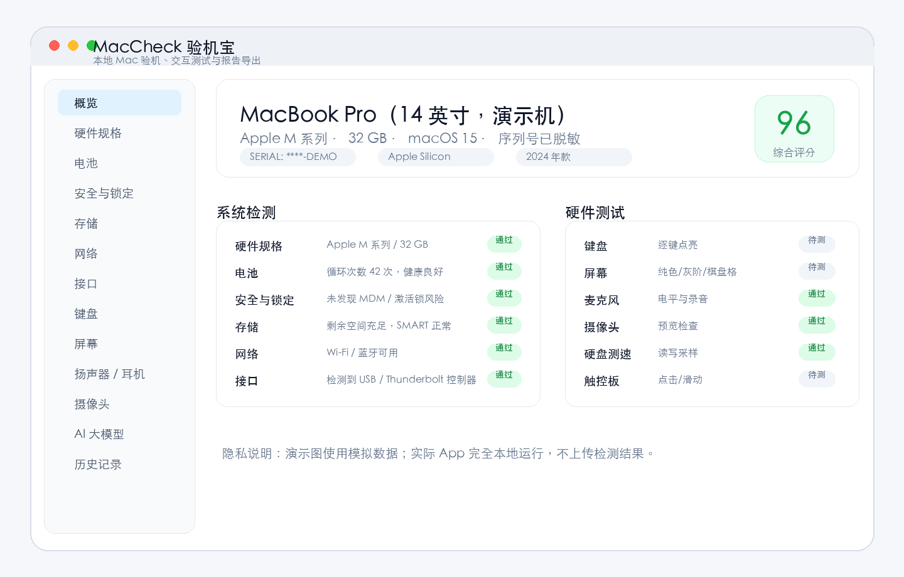
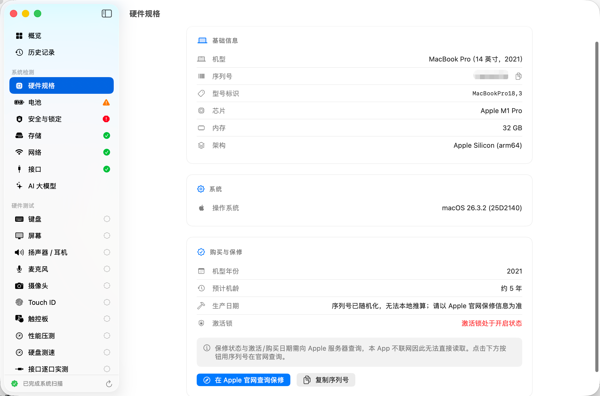
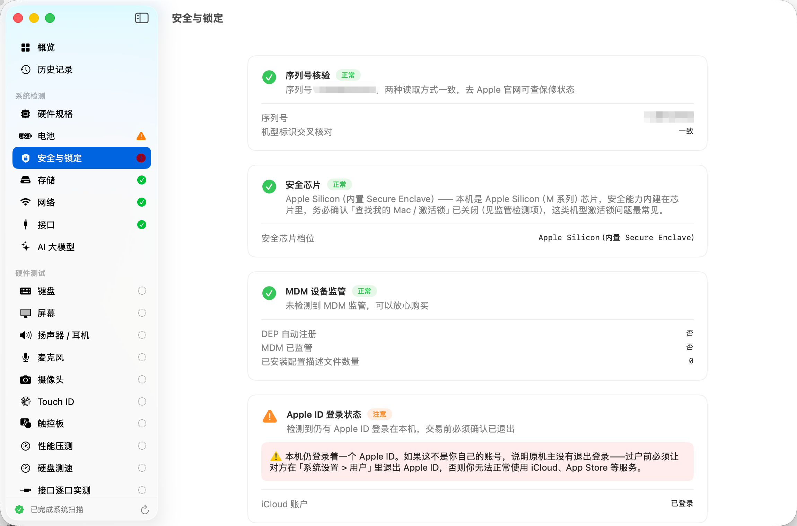
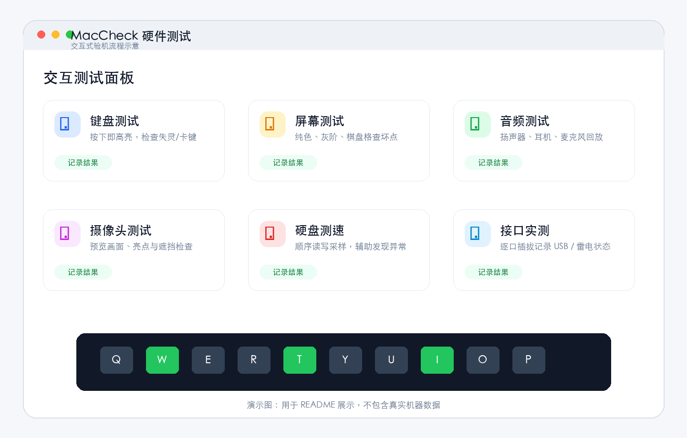

# MacCheck

[中文](README.md) | **English**

MacCheck is a local macOS inspection tool for buying and selling used Macs, in-store device checks, and personal self-checks. It automatically reads hardware specs, battery, storage, network, security, and port information, offers interactive tests for the keyboard, display, audio, microphone, camera, trackpad, and disk speed, and finally exports an inspection report as a PDF or PNG.

> Privacy: MacCheck runs entirely on your Mac by default. It never uploads your serial number, test results, or report contents. The images in this README are screenshots from real devices, with serial numbers and other sensitive details redacted.



## Features

- Automatically identifies model, chip, memory, macOS version, serial number, model year, and other basics
- Automatic checks for battery cycle count and health, storage, network, Bluetooth, and ports
- Flags high-risk items for used-Mac deals: MDM, Apple ID / Activation Lock, security chip, and more
- Interactive tests: per-key keyboard highlighting, solid-color / grayscale / checkerboard display patterns, audio, microphone, camera, Touch ID, trackpad, and more
- Disk read/write speed test, performance stress test, and port-by-port testing
- Local AI model suitability: estimates which local LLMs this Mac can run based on its memory
- One-click export of a PDF or long PNG report, with saved history for later comparison
- Appearance options: follow system, light, or dark
- English and Chinese UI: Settings → Language (System / 中文 / English); follows the macOS system language by default



## Requirements

- macOS 14.0 or later
- Apple Silicon or Intel Mac
- Xcode 16 or later to build from source
- Optional: `xcodegen`, to regenerate the Xcode project from `project.yml`

## Quick Install

1. Download `MacCheck-1.3.dmg` from GitHub Releases.
2. Open the DMG and drag `MacCheck.app` into `Applications`.
3. If Gatekeeper warns you on first launch, right-click the app and choose "Open".
4. Camera, microphone, Bluetooth, and similar checks request system permissions only when needed.

Starting with v1.3, the DMG is a Universal binary that runs on both Apple Silicon and Intel Macs (macOS 14+).

The release script supports Developer ID signing and Apple notarization. If no certificate is configured on your Mac, it produces an ad-hoc build, which is fine for local testing; for public distribution, set up signing and notarization.

### If the app won't open after installing

If macOS says the app "can't be opened because the developer cannot be verified", first try right-clicking `MacCheck.app` and choosing "Open".

If it still won't open, or you need the "Anywhere" option to appear under Privacy & Security, open Terminal and run:

```bash
sudo spctl --master-disable
```

Enter your login password and press Return. This enables the "Anywhere" option in System Settings and weakens Gatekeeper protection, so only use it when you trust the app's source.

If macOS says the app "is damaged and can't be opened", this is usually caused by the download quarantine attribute. After making sure the app is in `/Applications`, run in Terminal:

```bash
sudo xattr -rd com.apple.quarantine /Applications/MacCheck.app
```

## How to Use

1. Open MacCheck and wait for the home screen to finish the automatic system scan.
2. Review the "Overview" and "Major Issues" sections first; red items should be checked before anything else.
3. Work through the "Hardware Tests" items in the sidebar to complete the manual checks: keyboard, display, audio, camera, and so on.
4. Click "Save to History" to keep a snapshot of this inspection.
5. Click "Export Report" and choose a long PNG or a PDF.





## Building from Source

```bash
git clone https://github.com/andyhuo520/MacCheck.git
cd MacCheck

# Optional: only if you changed project.yml
brew install xcodegen
xcodegen generate

xcodebuild \
  -project MacCheck.xcodeproj \
  -scheme MacCheck \
  -configuration Release \
  -derivedDataPath build_release \
  CODE_SIGN_IDENTITY="-" \
  CODE_SIGNING_REQUIRED=NO
```

The build output is located at:

```text
build_release/Build/Products/Release/MacCheck.app
```

## Packaging the DMG

The project includes a release script:

```bash
./scripts/build_and_notarize.sh
```

The script will:

1. Regenerate the project automatically if `xcodegen` is installed
2. Build the Release configuration
3. Check whether a Developer ID Application certificate is available on this Mac
4. If a certificate is found, sign with the hardened runtime, notarize, and staple
5. If no certificate is found, produce an ad-hoc DMG that runs locally

Default output:

```text
~/Desktop/MacCheck-1.3.dmg
```

For official distribution, configure the following first:

```bash
export MACCHECK_SIGN_ID="Developer ID Application: Your Name (TEAMID)"
export MACCHECK_NOTARY_PROFILE="maccheck-notary"
```

Then save your notarization credentials with `xcrun notarytool store-credentials`, following Apple's official process.

## Testing

Manual inspection items require real hardware. Follow the [testing checklist](docs/TESTING.en.md). See also the [release notes](docs/RELEASE.en.md).

Basic local verification:

```bash
xcodebuild -project MacCheck.xcodeproj -scheme MacCheck -configuration Release -destination 'generic/platform=macOS' -derivedDataPath build_release CODE_SIGN_IDENTITY="-" CODE_SIGNING_REQUIRED=NO
hdiutil verify ~/Desktop/MacCheck-1.3.dmg
codesign -dv --verbose=2 build_release/Build/Products/Release/MacCheck.app
```

## Project Structure

```text
Sources/
  App/                 App entry point and Info.plist
  Core/                Hardware probing, reports, history, system services
  Checks/              Interactive tests: keyboard, display, audio, camera, etc.
  UI/                  SwiftUI views, design system, and navigation
scripts/
  build_and_notarize.sh
docs/
  TESTING.md / TESTING.en.md
  RELEASE.md / RELEASE.en.md
  assets/
```

## Notes

- This tool assists with inspecting a Mac; it does not replace Apple's official warranty or service diagnostics.
- Data that depends on Apple's servers, such as Activation Lock and warranty status, must be confirmed on Apple's website.
- Some checks depend on system permissions, model capabilities, or external devices; depending on your setup, results may show "Not Supported" or "Skipped".
- Before sharing screenshots or reports publicly, make sure the serial number, device name, and personal information are redacted.
